<div align="center">

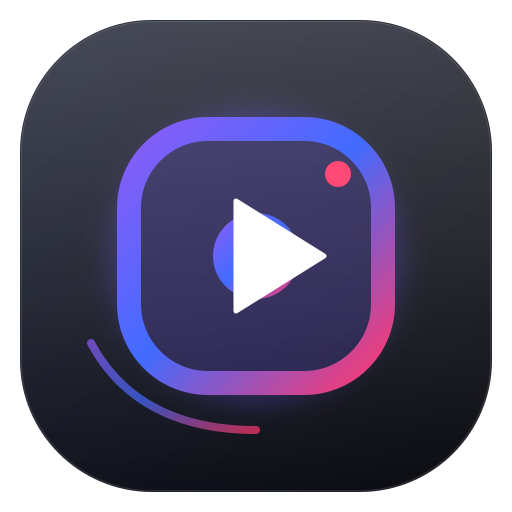

# InstaTube

**Media Extraction Studio for Android**

Extract and organize media from Instagram and YouTube links with a focused, dark-first interface.

[](https://github.com/xboyrex/InstaTube/releases/latest)
[](https://github.com/xboyrex/InstaTube/blob/main/LICENSE)
[](https://github.com/xboyrex/InstaTube/issues)
[](https://github.com/xboyrex/InstaTube/commits/main)

<br />

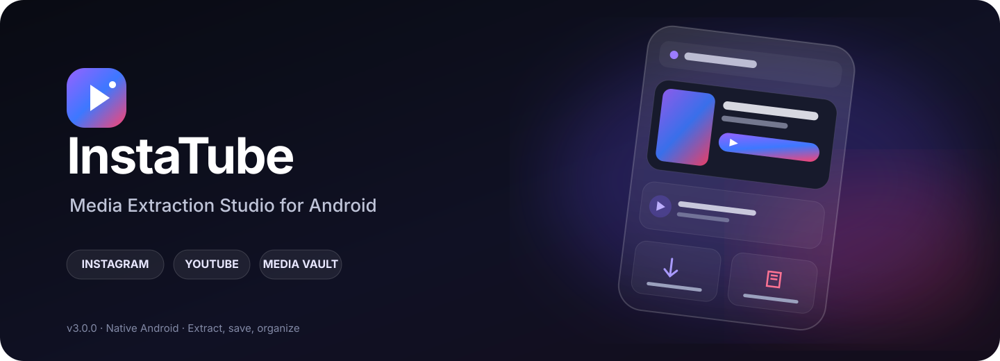

<br />

<a href="https://github.com/xboyrex/InstaTube/releases/latest"><strong>Download latest release</strong></a> · <a href="#screenshots">Explore screenshots</a> · <a href="https://github.com/xboyrex/InstaTube/issues">Report an issue</a>

</div>

---

## Overview

InstaTube (`v3.0.0` in the supplied app screenshots and current project documentation) is a native Android media-extraction utility for Instagram and YouTube links. Its workflow is designed around link inspection, choosing available media outputs, saving selected items, and finding finished exports in a local vault.

The interface uses a dark OLED mode, adjustable studio accents, a compact three-tab navigation bar, and dedicated settings for clipboard handling, notifications, storage, and the floating Instagram assistant.

> Use only for content you own or are authorized to save. You are responsible for following the source platforms' terms, copyright rules, and applicable law.

## Quick links

| Resource | Link |
| :--- | :--- |
| Latest APK / release notes | [GitHub Releases](https://github.com/xboyrex/InstaTube/releases/latest) |
| Source code | [Repository](https://github.com/xboyrex/InstaTube) |
| Bug reports | [Open an issue](https://github.com/xboyrex/InstaTube/issues) |
| Maintainer | [@xboyrex](https://github.com/xboyrex) |
| Telegram channel | [t.me/RoranoaxZORO](https://t.me/RoranoaxZORO) |

## At a glance

<table>
<tr>
<td width="50%" valign="top"> <strong>Smart link intake</strong><br />Paste a URL, inspect available media, and optionally use clipboard detection on launch.</td>
<td width="50%" valign="top"> <strong>Instagram media</strong><br />Extract supported reels, videos, images, carousels, cover artwork, and captions.</td>
</tr>
<tr>
<td valign="top"> <strong>YouTube streams</strong><br />Choose among available video resolutions or audio output for supported links.</td>
<td valign="top"> <strong>Local media vault</strong><br />Browse saved files by All, Video, Audio, and Artwork categories.</td>
</tr>
<tr>
<td valign="top"> <strong>Audio and artwork</strong><br />Dedicated audio export and cover-art saving actions are exposed in the extraction UI.</td>
<td valign="top"> <strong>OLED-first interface</strong><br />Choose Auto, Light, Dark, or OLED and tune the accent palette.</td>
</tr>
<tr>
<td valign="top"> <strong>Configurable behavior</strong><br />Clipboard detection, instant auto-download, notifications, haptics, and storage settings.</td>
<td valign="top"> <strong>Opt-in assistant</strong><br />The floating Instagram assistant is configurable in settings and requires Android special access.</td>
</tr>
</table>

## Animated interface preview

<div align="center">
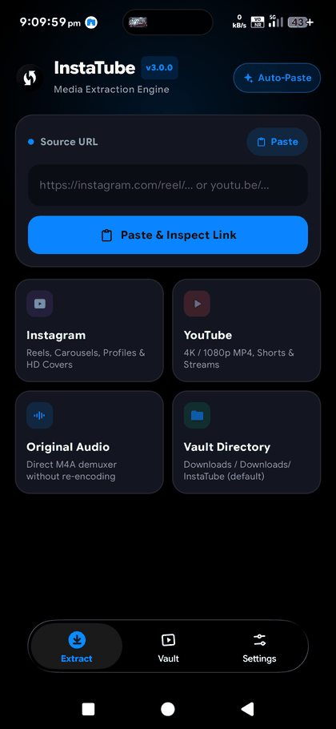
<p><sub>Preview generated from the supplied InstaTube screenshots. For the full-size captures, see the gallery below.</sub></p>
</div>

## Screenshots

The gallery below uses the 11 supplied app captures. Images are preserved at their original resolution and grouped by workflow.

### Extract and inspect

<div align="center">
<table>
<tr>
<td width="50%" align="center" valign="top">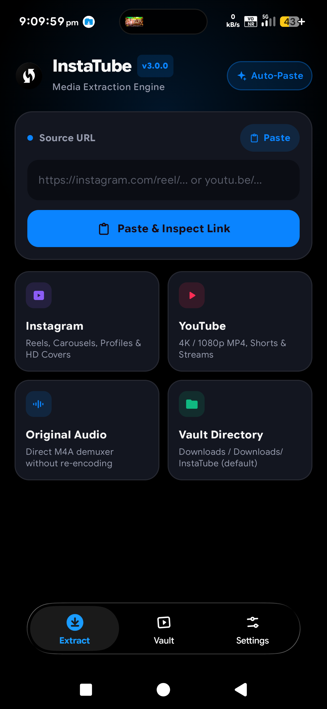<br /><strong>Extractor home</strong><br /><sub>Paste a link or use the source shortcuts.</sub></td>
<td width="50%" align="center" valign="top">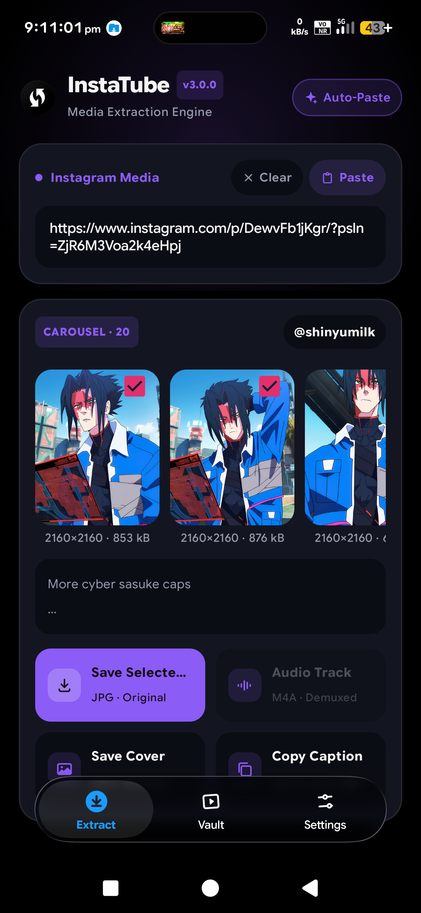<br /><strong>Instagram carousel</strong><br /><sub>Select the media items and choose an output action.</sub></td>
</tr>
<tr>
<td align="center" valign="top">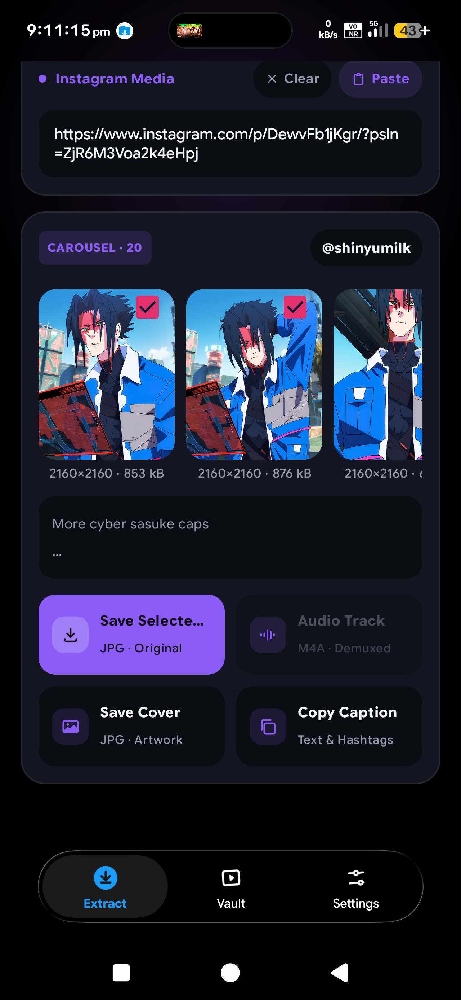<br /><strong>Media actions</strong><br /><sub>Save selected media, export audio or cover, and copy captions where available.</sub></td>
<td align="center" valign="top">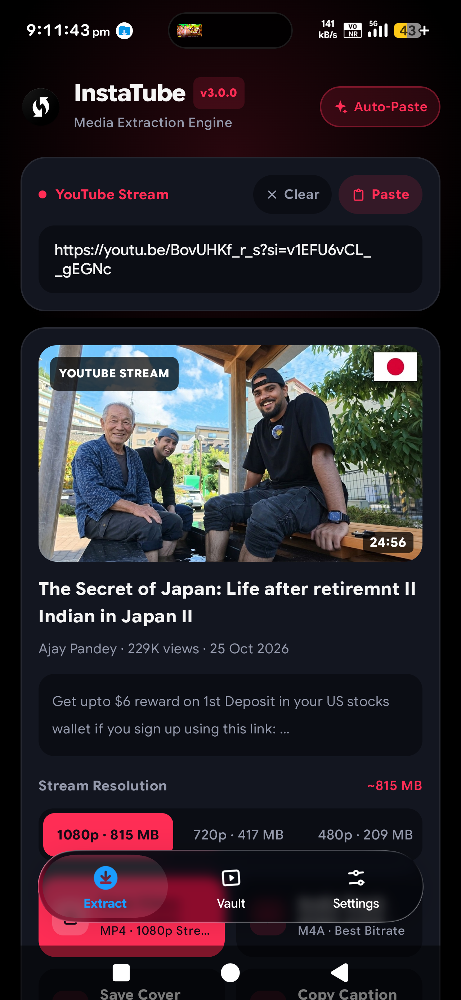<br /><strong>YouTube stream details</strong><br /><sub>Inspect available stream choices before saving.</sub></td>
</tr>
<tr>
<td align="center" valign="top">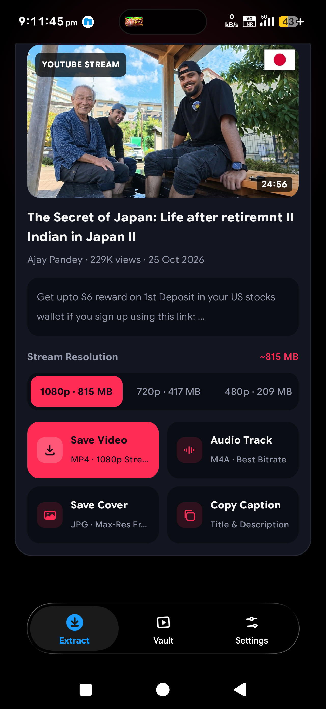<br /><strong>Video and audio actions</strong><br /><sub>Choose video, audio, cover artwork, or caption actions where supported.</sub></td>
<td align="center" valign="top">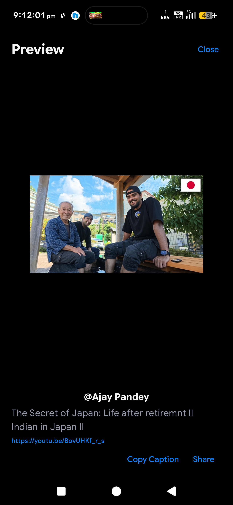<br /><strong>Media preview</strong><br /><sub>Review the media and access caption or share actions.</sub></td>
</tr>
</table>
</div>

### Vault and settings

<div align="center">
<table>
<tr>
<td width="50%" align="center" valign="top">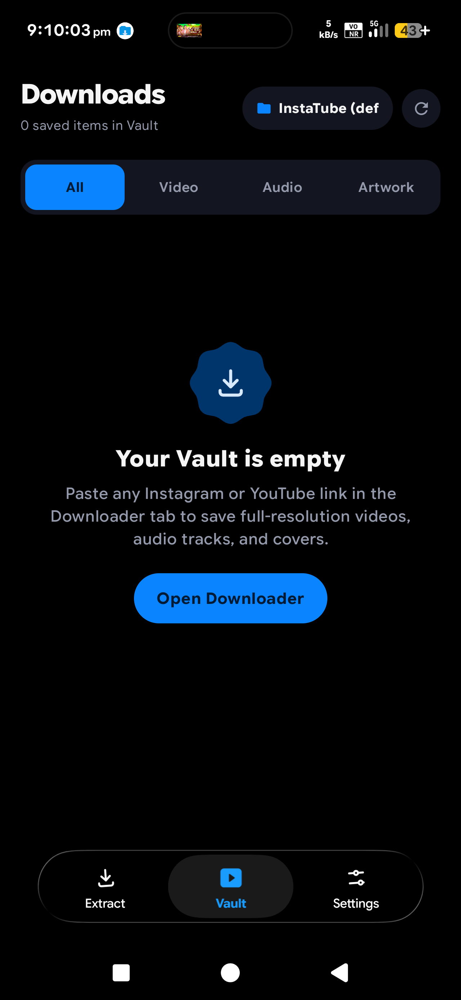<br /><strong>Vault empty state</strong><br /><sub>Downloads are organized by media category.</sub></td>
<td width="50%" align="center" valign="top">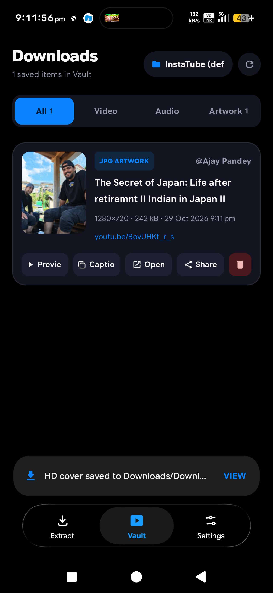<br /><strong>Saved downloads</strong><br /><sub>Open, preview, share, or manage downloaded items.</sub></td>
</tr>
<tr>
<td align="center" valign="top">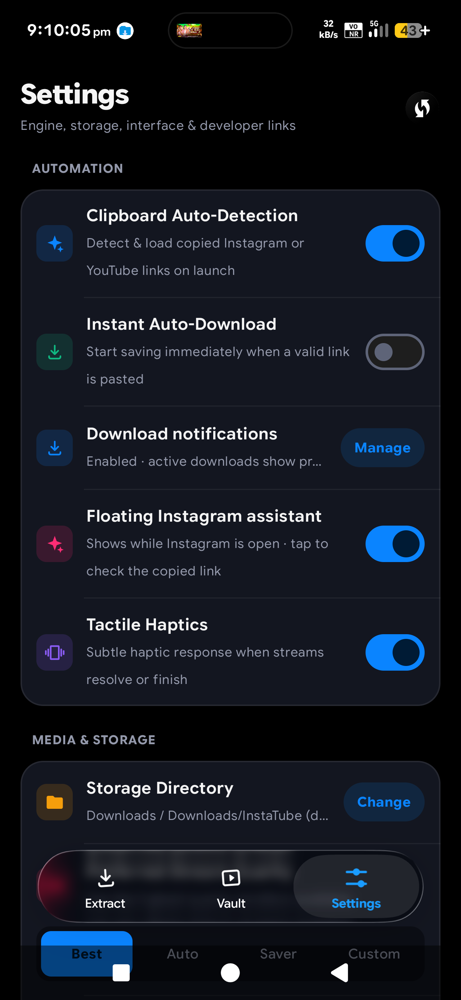<br /><strong>Automation settings</strong><br /><sub>Control clipboard behavior, auto-download, notifications, and assistant visibility.</sub></td>
<td align="center" valign="top">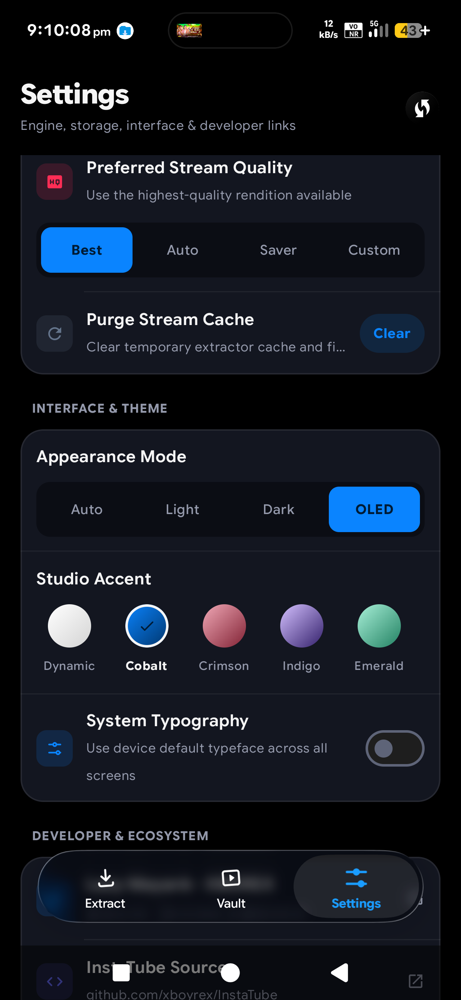<br /><strong>Quality and appearance</strong><br /><sub>Adjust output preferences, appearance mode, and studio accent.</sub></td>
</tr>
<tr>
<td align="center" valign="top">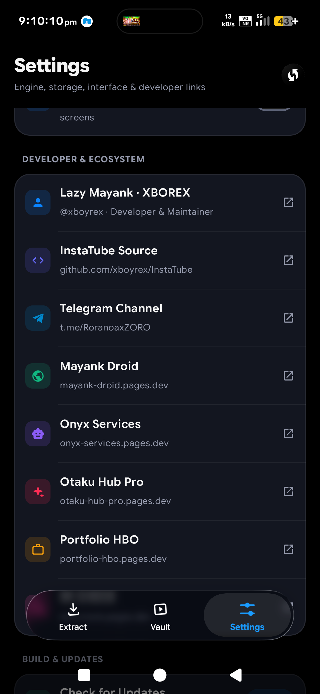<br /><strong>Developer and ecosystem</strong><br /><sub>Find project, maintainer, and related ecosystem links.</sub></td>
<td align="center" valign="top"><br /><strong>Brand system</strong><br /><sub>Original SVG mark and platform icon exports are included in the package.</sub></td>
</tr>
</table>
</div>

## Feature guide

### Link intake and clipboard automation

- Paste an Instagram or YouTube URL and select **Paste & Inspect Link** to start the extraction flow.
- Clipboard auto-detection can identify supported links when the app is launched.
- Instant auto-download is a separate setting and is disabled in the supplied screenshots; enable it only if that workflow is intended.
- Android's Share sheet is another practical way to hand a link to the app when the source app exposes one.

### Instagram extraction

- Supported public media types shown by the project include reels/videos, photos, and multi-item carousels.
- Select individual carousel items before saving.
- Save cover artwork and copy captions or hashtags where the source exposes the data.
- A floating Instagram assistant is available as an opt-in feature; Android's “Display over other apps” and “Usage access” permissions may be required.

### YouTube extraction

- Inspect available stream choices for supported videos, Shorts, and `youtu.be` links.
- Choose a listed video resolution and output, or select audio where available.
- Save cover artwork and copy available title/caption information from the action panel.
- Stream formats and resolutions depend on the source media and may change over time.

### Local vault and storage

- The Vault separates saved items into **All**, **Video**, **Audio**, and **Artwork** filters.
- Change the storage directory from Settings.
- Saved items expose quick actions such as preview, copy caption, open/share, and delete where supported by the item type.

### Interface and preferences

- Appearance modes shown: Auto, Light, Dark, and OLED.
- Studio accent choices include Dynamic, Cobalt, Crimson, Indigo, and Emerald.
- Additional settings cover download notifications, subtle haptics, clipboard handling, and the floating assistant.

## Install

1. Open [InstaTube Releases](https://github.com/xboyrex/InstaTube/releases/latest).
2. Download the latest APK asset provided for the release.
3. Open the APK on your Android device and complete the system installer flow. Android may require permission to install apps from the selected source.

The project documentation identifies Android 7.0 (API 24) as the minimum SDK. Availability of a particular APK variant depends on what is attached to the selected release.

## Build from source

The project is an Android/Gradle codebase. On a machine with a compatible JDK and Android SDK installed:

```bash
git clone https://github.com/xboyrex/InstaTube.git
cd InstaTube
./gradlew assembleDebug
```

On Windows, use `gradlew.bat assembleDebug`. Android SDK packages and a compatible JDK must be installed and configured first. The generated debug APK is normally located beneath the app module's `build/outputs/apk/debug/` directory; check the Gradle output for the exact path.

## Release signing and update safety

- Never commit a release keystore or signing passwords.
- The repository's release setup documents `INSTATUBE_RELEASE_KEYSTORE_BASE64`, `INSTATUBE_RELEASE_KEYSTORE_PASSWORD`, `INSTATUBE_RELEASE_KEY_ALIAS`, and `INSTATUBE_RELEASE_KEY_PASSWORD` as GitHub Actions secrets for persistent release signing.
- APKs installed as updates must match the application ID and signing certificate of the installed app. A different signing key may require uninstalling the old build first, which can remove app data.

## Privacy and platform responsibility

InstaTube is an independent project. It is not affiliated with or endorsed by Instagram/Meta, YouTube, or Google. Respect each service's terms, privacy expectations, and copyright rules. Download or redistribute media only when you have the required rights or permission. Review the source code and Android permissions before enabling optional automation features.

## Maintainer and ecosystem

| Resource | Link |
| :--- | :--- |
| GitHub profile | [github.com/xboyrex](https://github.com/xboyrex) |
| InstaTube source | [github.com/xboyrex/InstaTube](https://github.com/xboyrex/InstaTube) |
| Telegram channel | [t.me/RoranoaxZORO](https://t.me/RoranoaxZORO) |
| Mayank Droid | [mayank-droid.pages.dev](https://mayank-droid.pages.dev) |
| Onyx Services | [onyx-services.pages.dev](https://onyx-services.pages.dev) |
| Otaku Hub Pro | [otaku-hub-pro.pages.dev](https://otaku-hub-pro.pages.dev) |
| Portfolio | [portfolio-hbo.pages.dev](https://portfolio-hbo.pages.dev) |
| Mi Unlock | [mi-unlock.pages.dev](https://mi-unlock.pages.dev) |

## Contributing

Bug reports and reproducible issues are welcome through [GitHub Issues](https://github.com/xboyrex/InstaTube/issues). Include the InstaTube version, Android version, source type (Instagram or YouTube), a concise reproduction sequence, and sanitized logs when relevant. Do not post private URLs, access tokens, cookies, or personal media.

## License

See the repository's [LICENSE](https://github.com/xboyrex/InstaTube/blob/main/LICENSE) file for the applicable license terms.

<div align="center">


**InstaTube · Media Extraction Studio**

<sub>Designed for a clean workflow. Built for your media library.</sub>

</div>
